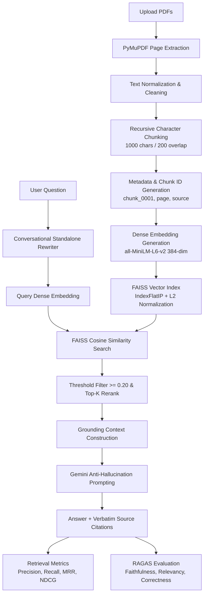

# 🧠 ContextIQ — Document Intelligence & Production RAG System

[](https://www.python.org/)
[](https://streamlit.io/)
[](https://github.com/facebookresearch/faiss)
[](https://huggingface.co/sentence-transformers/all-MiniLM-L6-v2)
[](https://ai.google.dev/)
[](https://github.com/explodinggradients/ragas)

**ContextIQ** is a modular, production-ready Retrieval-Augmented Generation (RAG) system built to organize, search, and extract grounded insights from collections of PDF documents. It enforces strict context grounding, provides verbatim citations (source filename, page number, similarity score), and includes end-to-end quantitative evaluation across both retrieval (Precision@K, Recall@K, MRR, Hit Rate@K, NDCG@K) and generation (RAGAS Faithfulness, Answer Relevance, Context Precision, Context Recall, Answer Correctness).

---

## 🏗️ Architecture Pipeline



---

## ⚡ Core Features

- **Multi-Document Ingestion**: Batch drag-and-drop processing of multi-page PDFs with page tracking and error resilience.
- **Recursive Semantic Chunking**: Respects paragraph breaks (`\n\n`), single linebreaks (`\n`), sentence endings (`. `), and whitespace fallbacks with customizable overlap.
- **Normalized Dense Vector Store**: FAISS `IndexFlatIP` combined with $L_2$ normalization computes exact cosine similarity without vector distortion.
- **Context-Grounded Generation**: Zero-hallucination system prompt that admits when information is absent and formats inline source citations: `(Source: filename.pdf, Page: X)`.
- **Conversational Memory**: Standalone query rewriting component resolves follow-up references (*"it"*, *"they"*, *"how does that work?"*) into self-contained search queries.
- **Knowledge Discovery**: Cross-document synthesis, knowledge gap identification, and side-by-side comparative analysis.
- **Rigorous Dual Evaluation Suite**:
  - **Retriever Quality**: Precision@K, Recall@K, Reciprocal Rank (MRR), Hit Rate@K, and Normalized Discounted Cumulative Gain (NDCG@K).
  - **Generation Quality (RAGAS)**: Faithfulness (hallucination detection), Answer Relevance, Context Precision, Context Recall, and Answer Correctness.

---

## 📊 Evaluation Benchmark Results

Evaluated against our ground-truth benchmark suite:

### 1. Retriever Metrics ($K=3$)

| Metric | Raw Top-3 (Baseline) | With Similarity Filter ($\ge 0.20$) | Impact |
|---|---|---|---|
| **Precision@3** | `0.3333` | **`0.5417`** | **+62.5% improvement** (distractors eliminated) |
| **Recall@3** | `1.0000` | **`1.0000`** | **100%** target coverage preserved |
| **MRR@3** | `1.0000` | **`1.0000`** | Relevant chunk always placed at Rank 1 |
| **Hit Rate@3** | `1.0000` | **`1.0000`** | 100% queries retrieved target evidence |
| **NDCG@3** | `1.0000` | **`1.0000`** | Optimal logarithmic ranking discount |

### 2. RAGAS Generation Metrics (Gemini Judge)

| RAGAS Dimension | Score | Significance |
|---|---|---|
| **Faithfulness** | **`1.0000`** | **100% Grounded** — Zero hallucinations detected across generated answers. |
| **Answer Relevancy** | **`0.9105`** | **91.1% Pertinence** — Responses directly answer the user prompt without drift. |
| **Context Precision** | **`1.0000`** | **100% Top-Rank** — Retrieved relevant chunks placed at optimal positions. |
| **Context Recall** | **`0.7500`** | **75.0% Completeness** — Captures key facts required by reference answers. |
| **Answer Correctness**| **`0.8177`** | **81.8% Accuracy** — Strong semantic agreement with authoritative answers. |

---

## 🛠️ Technology Stack

| Component | Selected Technology | Purpose / Rationale |
|---|---|---|
| **Language** | Python 3.12 | Core programming environment |
| **UI Framework** | Streamlit | Responsive, stateful web interface |
| **PDF Extraction** | PyMuPDF (`pymupdf`) | High-speed text extraction with page metadata |
| **Text Chunking** | Custom Recursive Character Splitter | Modular boundary-aware splitting |
| **Embedding Model** | `all-MiniLM-L6-v2` (SentenceTransformers) | Fast, 384-dimensional dense semantic vectors |
| **Vector Store** | FAISS CPU (`IndexFlatIP`) | Fast, local exact cosine similarity search |
| **LLM Inference** | Google Gemini (`gemini-3.5-flash-lite`) | Context synthesis, query rewriting & citations |
| **Evaluation** | RAGAS + Scikit-Learn | Generation grounding & retrieval ranking evaluation |

---

## 🚀 Quickstart Guide

### 1. Clone & Set Up Environment

```bash
git clone https://github.com/your-username/ContextIQ.git
cd ContextIQ

# Create and activate virtual environment
python -m venv venv
# On Windows:
.\venv\Scripts\Activate.ps1
# On macOS/Linux:
source venv/bin/activate

# Install dependencies
pip install -r requirements.txt
```

### 2. Configure Environment Secrets

Copy `.env.example` to `.env` and insert your Gemini API Key:
```bash
cp .env.example .env
```

Edit `.env`:
```env
GEMINI_API_KEY=your_gemini_api_key_here
GEMINI_MODEL=gemini-3.5-flash-lite
```

### 3. Run the Application

```bash
streamlit run app.py
```
Open your browser at `http://localhost:8501`.

### 4. Run Evaluation Benchmarks

```bash
# Run dense retrieval evaluation
python src/evaluation/run_evaluation.py

# Run RAGAS generation & hallucination evaluation
python src/evaluation/ragas_evaluator.py
```

---

## 📂 Project Structure

```
ContextIQ/
├── app.py                            # Streamlit Web Application
├── requirements.txt                  # Python dependencies
├── .env.example                      # Template environment configuration
├── .gitignore                        # Git ignore rules for secrets & indexes
├── test_end_to_end.py                # Automated end-to-end integration test
├── README.md                         # Project documentation
├── data/
│   ├── index/                        # FAISS index & evaluation reports
│   │   ├── faiss.index               # Vector index file
│   │   ├── metadata.json             # Document metadata mapping
│   │   ├── evaluation_report.json    # Retrieval benchmark report
│   │   └── ragas_report.json         # RAGAS evaluation report
│   └── uploads/                      # Uploaded PDF documents
└── src/
    ├── rag_pipeline.py               # Main RAG orchestration pipeline
    ├── create_sample_pdf.py          # Sample PDF generator
    ├── chunking/
    │   └── recursive_chunking.py     # Recursive character text splitting
    ├── embeddings/
    │   ├── embedding_model.py        # SentenceTransformer 384-dim embeddings
    │   └── similarity.py             # Cosine & dot-product utilities
    ├── ingestion/
    │   ├── document_loader.py        # PyMuPDF text & page extractor
    │   └── knowledge_base_manager.py # Multi-PDF incremental ingestion
    ├── metadata/
    │   └── metadata_manager.py       # Chunk ID & source metadata manager
    ├── preprocessing/
    │   └── text_cleaner.py           # Whitespace cleaning & formatting
    ├── vectorstore/
    │   ├── faiss_store.py            # FAISS IndexFlatIP & benchmarks
    │   ├── persistence.py            # FAISS & metadata JSON persistence
    │   └── retriever.py              # Filtered Top-K retrieval
    ├── llm/
    │   ├── gemini_client.py          # Gemini API client wrapper
    │   ├── prompt_builder.py         # Grounding & citation prompt template
    │   ├── conversation_manager.py   # Standalone query rewriting
    │   └── knowledge_discovery.py    # Multi-doc synthesis & gap analysis
    └── evaluation/
        ├── evaluation_dataset.py     # Ground-truth test queries & answers
        ├── retrieval_evaluator.py    # Precision, Recall, MRR, HitRate, NDCG
        ├── run_evaluation.py         # Retrieval evaluation benchmark
        └── ragas_evaluator.py        # RAGAS generation evaluation runner
```

---

## 📄 License
MIT License.
